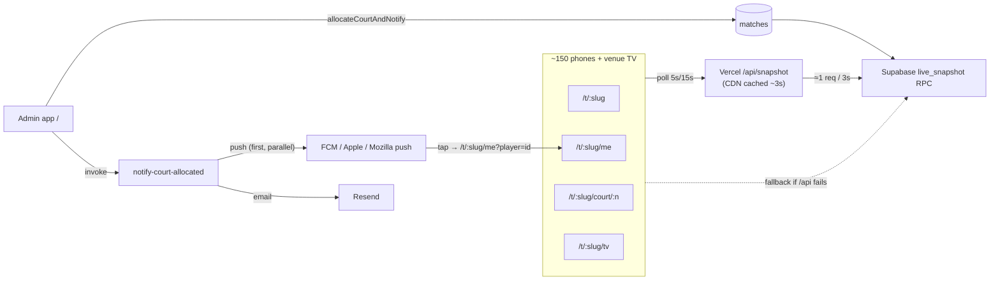
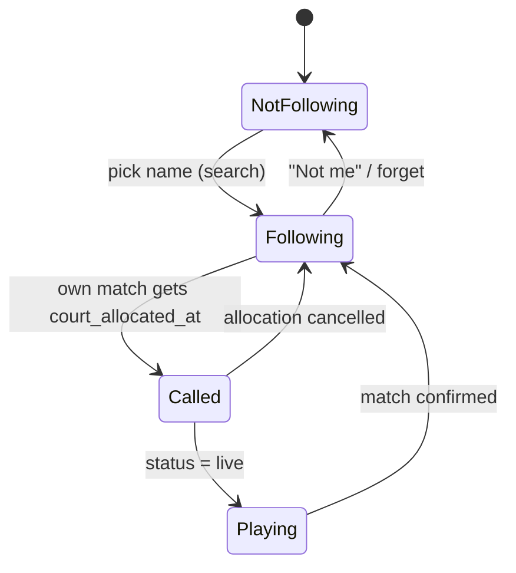
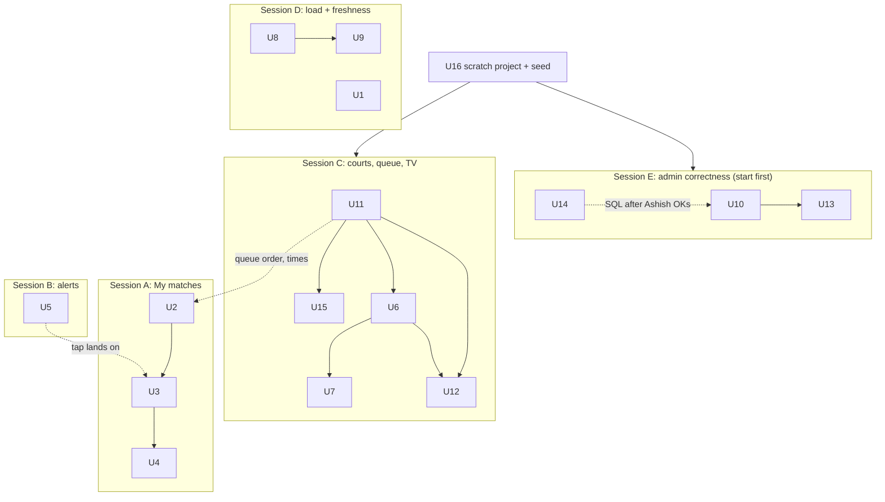

# Race Day 2026 - Plan

**Event:** Shuttle Storm '26, Sat Nov 21 2026, UFV North Gym (Abbotsford), 4 courts, 9:30 am start. Registration closes Nov 18.
**Target repo:** `ashishdawar09-dotcom/vite-react` (Vite + React 19 + TS + Supabase `wdqooznwzesmjdvlcrxw`, Vercel `badminton.adawar.org`).
**This document is a plan only.** Nothing here has been built. Each unit is sized for its own build session after Ashish approves.

---

## Goal Capsule

- **Objective:** On Nov 21 every player can pull up their own matches on their phone and learns within about a minute, without asking the desk, that their match has a court. Volunteers point people to the right page with printed QR codes. No admin tap can silently corrupt results. The public pages stay fresh for ~150 phones plus the venue TV all day, and nothing about getting there writes production data except migrations Ashish approves (U14); production reads are limited to read-only checks.
- **Means:** extend the existing public pages, push pipeline and polling path (KTD1–KTD7). The one new serving layer is the cached snapshot function (KTD5).
- **Authority:** Ashish approves this plan and every production SQL change. Requirements (R-IDs) win on behaviour; KTDs win on mechanism; units override neither.
- **Stop conditions:**
  - Stop and ask before any migration, `supabase db push`, or other production write. There is no staging database.
  - Stop if a unit needs a reset, wipe or bulk-delete control in the admin app. Those are not allowed.
  - Code freeze after the evening of Thu Nov 19. After that, only fixes Ashish asks for.
- **Execution profile:** one build session per unit group (see Sequencing), each on its own branch and PR. Ashish reviews and merges. Lint, typecheck, tests and build must pass locally because Vercel previews lack Supabase env vars.

---

## Product Contract

### Summary

Add a "My matches" view at `/t/:slug/me`. A player finds their name once, the phone remembers them, and the view shows their upcoming matches and a large "Court N, head there now" banner when a court is assigned. The view also offers web push, reusing the existing `subscribe-push` and `notify-court-allocated` functions; the notification deep-links back to the view. Add a per-court live page and an admin-only printable QR sheet. Put the spectator polling path behind a short-lived CDN cache so phone count no longer drives Supabase load or egress, and prove it with a load test against a throwaway Supabase project. Fix the race-day hazards a code sweep found. The worst are a "Sit Out" button that deletes a player's teams and results in every category, and knockout winners that can be written into another category's bracket. Others are projected times that ignore court sharing, push taps that open the admin login, and admin screens that go stale silently.

### Problem Frame

The app already has a live spectator page (`/t/:slug`), venue TV (`/t/:slug/tv`), results, player profiles (`/p/:id`, which already lists a player's upcoming matches), check-in, and court-allocated email plus push. On race day, though, the parts don't connect for a player:

- A player has to scroll the full `LiveTab` and tap their own name to see their matches. Nothing remembers who they are.
- The only push opt-in is on the registration success screen. Production has 2 player push subscriptions and 0 pending ones (read-only query, Oct 24), so almost nobody will get a push today.
- A push tap opens `/` (`supabase/functions/notify-court-allocated/index.ts`, payload `url: "/"`), which is the admin app's sign-in screen.
- Projected start times are simulated per category against all four courts (`src/hooks/useScheduling.ts`, one fresh `queues` array per category). Shuttle Storm has two categories both starting at 9:30 and up to ten sharing four courts, so every category projects as if it owned the gym. "In 5 min" estimates will be badly optimistic.
- Every spectator phone polls the `live_snapshot` RPC directly every 5 s while anything is live (15 s otherwise). The snapshot is already ~31 KB with zero matches (players and player-categories are most of it; the waiver text alone is 3.2 KB and is re-sent on every poll). With ~100 matches it roughly triples. At ~150 phones that is ~30 requests/s to the Free-plan project and several GB of egress in one day (see Load model).
- There is no per-court page and no QR code anywhere. Spectator court cards say only "FREE, available for next match", with nothing about what is next on that court.
- The venue TV at 1920×1080 uses fixed 10–16 px labels and leaves half the screen empty. When idle it shows one "No matches live" banner instead of Courts 1–4.
- The spectator page never shows the 9:30 start time or the venue map link, although both are in the data.
- Public pages render the event date as Fri Nov 20 in Pacific time (`src/features/publicSpectator/PublicSpectatorPage.tsx`, `ResultsPage.tsx` use `new Date("2026-11-21")`). This is being fixed in [PR #43](https://github.com/ashishdawar09-dotcom/vite-react/pull/43), which adds `src/lib/dates.ts` (`parseLocalDate`/`formatLocalDate`), so it is out of scope here. New date-only formatting in this plan uses that helper.

Current state at 375 px (Oct 24, no matches drawn yet): [spectator](race-day-2026/spectator-375.png), [player profile](race-day-2026/profile-375.png), [venue TV at 1920](race-day-2026/tv-1920.png).

### Actors

- A1. Player: on their own phone, often on poor gym signal, mostly iPhone Safari, not installed as an app.
- A2. Spectator or parent: same pages, may want to follow a child.
- A3. Admin (Ashish, Dr. Arya): runs courts from the admin app at `/`. Allocating a court is the trigger for every alert.
- A4. Venue TV: an unattended browser on `/t/:slug/tv` for nine hours.

### Requirements

**My matches**
- R1. From `/t/:slug` a player reaches their own "My matches" view in at most three taps by searching their name. Results show category and partner so two "Sagar"s can be told apart.
- R2. The choice is remembered on that device without login. Revisiting `/t/:slug` offers "My matches" directly, and the player can switch or forget.
- R3. My matches lists the player's upcoming matches in play order with category, opponent and court once assigned, plus finished results. Time estimates only appear when they are trustworthy (R13).
- R4. While any public page for the tournament is open, a court assignment for a followed player's match shows a prominent banner ("Court 3: head there now", opponent) within one poll cycle, whether or not push is enabled.
- R5. From My matches a player can turn on push notifications. A court assignment then produces a notification whose tap opens their My matches view.
- R6. On iPhone Safari outside a Home Screen app, the push control is replaced by short add-to-Home-Screen steps and the fallback (keep this page open, check email). Android and desktop browsers subscribe in the tab.
- R7. The court-allocated email keeps working as the fallback for everyone with an email on file.

**Courts and QR**
- R8. A per-court page shows what is on that court now (warm-up or live, teams, score) and what is next in the shared queue, labelled "court TBA". Courts are only named once an admin allocates.
- R9. Admins can open a print view that produces one Letter page per court (QR to that court's page, large court number) and one check-in poster (QR to `/t/shuttle-storm`). Printing needs no network calls beyond the app itself.

**Load and freshness**
- R10. The public pages and TV keep working for 150 concurrent phones over a nine-hour day without exceeding Supabase Free-plan quotas or rate limits.
- R11. Public pages show how fresh their data is and say when they cannot reach the server, so stale scores on bad gym signal are obvious.
- R12. Load readiness is demonstrated with a test at 1.5x expected load that writes nothing to the production database.

**Race-day correctness**
- R13. Projected start times account for all categories sharing the tournament's courts, or are not shown as clock times.
- R14. The admin and public-page hazards found in the code sweep (U10, U13–U15, and "Accepted for race day") are fixed or explicitly accepted by Ashish before Nov 19.

### Key Decisions

- **No player login; the follow lives on the device.** Player ids and match data are already public, so localStorage plus the public id adds no exposure. Governs R1, R2.
- **One followed player per device for push.** `push_subscriptions.endpoint` is unique, so a browser maps to one player; the on-page banner can still follow several. Changing that needs a migration and is left as an open question. Governs R4, R5.
- **Email stays on for every court allocation.** It is the only channel that reaches iPhones that never install the app. Governs R7.

### Acceptance Examples

- AE1. Covers R4. Given Priya follows herself on her phone and the page is open, when the admin allocates Court 3 to her match, then within one poll cycle the page shows "Court 3: head there now" with her opponent, and the banner clears once the match is confirmed.
- AE2. Covers R5. Given Priya enabled push on Android Chrome and closed the tab, when Court 3 is allocated, then her phone shows "Court 3 is yours" and tapping it opens `/t/shuttle-storm/me` showing that match.
- AE3. Covers R6. Given Priya is on iPhone Safari in a normal tab, when she opens My matches, then she sees add-to-Home-Screen steps instead of an enable button, and the banner still works while the page is open.
- AE4. Covers R13. Given Men's Doubles 18–34 and Men's Doubles 35+ both start at 9:30 with 4 courts, when the projection runs, then the two categories' first-round matches do not both project onto Courts 1–4 at 9:30.

### Scope Boundaries

**Non-goals, considered and not built**
- SMS alerts. They need a paid provider and phone numbers the registration form does not collect. Revisit if push opt-in on race day is low.
- Slimming the snapshot payload. With the cache, egress is ~0.2 GB a day, so the ~4 KB saved per response changes nothing material. Revisit only if U8 doesn't ship.
- Spectator Realtime subscriptions. Polling through a cache is cheaper and survives flaky Wi-Fi better (KTD5).
- Player accounts or sign-in. The data is public; login would only add friction.
- A server-side notification trigger on `matches.court_allocated_at`. Allocation already goes through one client helper (`db.allocateCourtAndNotify`, both call sites in `src/App.tsx` and `src/components/MatchesTab.tsx`). A trigger would mean a production migration plus pg_net in the hot path. Reconsider if `notification_log` shows gaps after the event.

### Deferred to Follow-Up Work

- Following several players per device for push (needs a `push_follows` table). See Open Questions.
- Unifying `publicDerive.ts` with `useTournamentDerived.ts`; the duplication is already noted in the code.

---

## Planning Contract

### Key Technical Decisions

- KTD1. **My matches is a new route, `/t/:slug/me`, reusing the spectator data pipeline.** It mounts `usePublicTournament` like the other `/t/:slug/*` pages and takes the followed player from localStorage, or from `?player=<id>` so push deep links work even when storage was cleared. Upcoming and recent match derivation moves out of `PlayerProfileView.tsx` into a pure helper shared by both. Because the manifest has no `start_url`, adding this page to the Home Screen opens straight into it.
- KTD2. **The court banner is derived client-side from the polled snapshot.** A followed player's match with `court_allocated_at` set, not confirmed, is "called". No new backend. Worst-case delay is one idle poll (15 s), since the poll drops to 15 s when nothing is live.
- KTD3. **Push reuses `subscribe-push` with `kind: "player", player_id`.** That path already exists and validates the player belongs to the tournament. `notify-court-allocated` already fans out to `push_subscriptions` by `player_id`. Changes are edge-function only: deep-link URL, `TTL` and `urgency: "high"` options, and sending push before and in parallel with email. No SQL.
- KTD4. **Projected times use one shared court queue across all categories (R13).** It runs in two passes: first seed every court from live, warming and confirmed matches across all categories, then place pending matches. Pending matches are sorted by category `starts_at`; categories with the same start are interleaved round-robin by within-category position. A projected court stays internal and is never shown as an assignment (R8). My matches leads with queue position ("3 matches before yours") and shows clock times only as "around 10:40".
- KTD5. **Spectators read the snapshot through a same-origin, CDN-cached endpoint.** A Vercel function at `/api/snapshot` calls `live_snapshot` with the publishable key and returns it with a short shared cache (about 3 s fresh, stale-while-revalidate). Supabase then sees roughly one request every few seconds regardless of phone count, and egress moves to Vercel's CDN. If the endpoint fails (non-200, non-JSON, or unparseable), that one poll goes to the direct RPC and the next poll tries the endpoint again. After 3 consecutive failures the client polls the RPC at 30 s and re-checks the endpoint every 60 s, so an outage costs at most a sixth of today's direct load. The function sends `stale-if-error` so the CDN keeps serving the last good snapshot through brief Supabase errors. CSP already allows `connect-src 'self'`.
- KTD6. **Load testing runs against a throwaway Supabase project, never production.** The empty project `aabsbcvzknsdbirrmlfr` in Org B is the candidate (CLAUDE.md lists it as empty and likely deletable). It gets the migrations plus a synthetic Shuttle Storm-sized seed. Production gets at most a short, low-rate read-only smoke after Ashish agrees.
- KTD7. **QR codes are generated in the browser as SVG** with `lean-qr`, on an admin-only lazy-loaded print route. No third-party QR service, so the CSP stays unchanged and printing works offline.

### High-Level Technical Design

Data flow on race day after this plan:

My matches state on the player's phone:

### Load model

Egress is the risk, not request rate. Measured Oct 24 (read-only): `live_snapshot` for `shuttle-storm` is 31 KB raw, 8.4 KB gzip, 6.7 KB brotli, with 36 players, 14 teams and 0 matches. A match row adds roughly 0.75 KB raw, so ~100 matches makes it ~105 KB raw, ~20 KB compressed.

| Scenario (9 h day, 150 phones, ~70 % with page in foreground) | Requests to Supabase | Supabase egress |
|---|---|---|
| Today's direct polling, today's payload | ~680k | ~5.7 GB |
| Today's direct polling, race-day payload | ~680k | ~13 GB |
| Cached endpoint (KTD5), ~1 origin request per 3 s | ~11k | ~0.2 GB |

The Free plan allows 5 GB of uncached egress per billing cycle, for the whole of Org A, so sangat-planner shares it. Going over triggers a grace period and then possible Fair Use restrictions on every project in the org, including HTTP 402 on API calls. The org gets only one grace period. Request rate is unlimited on paper, but ~30 req/s on a shared-CPU Nano instance is unmeasured; U9 measures it.

Realtime is not on the spectator path today: only admin devices open a channel (`src/hooks/useTournamentData.ts`), far under the Free plan's 200 concurrent connections. On Vercel the cached endpoint costs few function invocations (one per cache miss, ~11k), but every phone poll is still a CDN request: about 680k on race day, roughly two-thirds of Hobby's 1M monthly CDN requests. That fits, but with little margin for page loads and assets, and Hobby's commercial-use clause applies anyway (OQ4). The load model assumes 150 phones (players plus parents and spectators) against 36 registered players today, so it is a ceiling, not a forecast.

### Assumptions

These were inferred without a live answer from Ashish. Correct any that are wrong before build sessions start.

- Most players will not have installed the app, so the on-page banner and email do most of the work and push is a bonus.
- Admins keep allocating courts from the existing Live/Matches tabs. No auto-allocation is wanted.
- Shuttle Storm stays on Supabase Free unless Ashish chooses Pro for November (Open Questions).
- The venue has usable cell coverage or Wi-Fi. Freshness indicators (R11) make the failure visible but cannot fix it.

### Sequencing

U16 (scratch project and seed) lands first, before any session needs to verify on it. Then five build sessions can run in parallel. Session E starts first because U10 guards against corrupted results. Session B's first step (prove push delivers from Supabase Edge) is a half-day spike that decides how much U4 is worth.

Shared files need ordering, not separate owners:
- `src/hooks/useTournamentData.ts`: U1, U8, U13 (admin branch), U15 (tournament refresh). Land U1 first; the others rebase.
- `src/lib/db.ts`: U8, U10, U14. `src/App.tsx` and `src/components/MatchesTab.tsx`: U10, U13, U14. `src/components/MatchCard.tsx`: U10, U13. These sit in Session E except U8's `liveSnapshot` change.
- `src/features/publicSpectator/PublicSpectatorPage.tsx`: U1, U3, U15, each in a different part of `PublicPageShell` or the page body.
- `src/features/publicSpectator/VenueTvPage.tsx`: U1, U12. `courtView.ts`: U6 creates it, U12 extends it.
- `src/main.tsx` gets one route line each from U3, U6 and U7.

Target: everything merged by Sat Nov 14, dress rehearsal Nov 17, freeze Nov 19.

---

## Implementation Units

### Effort and risk at a glance

| Unit | What | Effort | Risk | Production change |
|---|---|---|---|---|
| U1 | Freshness badge on public pages | S (½ day) | Low | Front-end deploy |
| U2 | My matches derivation + name search (pure) | S | Low | None until U3 |
| U3 | `/t/:slug/me`, follow, court-call banner | M (1–1½ days) | Low–Med | Front-end deploy |
| U4 | Push opt-in on My matches, iOS guidance | M (1 day + device testing) | Med | Front-end deploy |
| U5 | Court-alert push: prove delivery, deep link, urgency, push-first | S–M (½–1 day) | Med–High until delivery is proven | Edge-function deploy |
| U6 | Per-court live page | S | Low | Front-end deploy |
| U7 | Admin QR print sheet | S | Low | Front-end deploy, one new npm dep |
| U8 | CDN-cached snapshot endpoint with per-poll fallback | M (1 day) | Med | New Vercel function, `vercel.json` |
| U9 | Load test on a throwaway Supabase project | M (1 day) | Low | None (scratch project only) |
| U10 | Admin correctness blockers (Sit Out, knockout propagation, walkover, guards) | M (1 day) | Med | Front-end deploy |
| U11 | Shared court queue for projected times | M (1 day) | Med | Front-end deploy |
| U12 | Venue TV legibility and court tiles | S | Low | Front-end deploy |
| U13 | Admin resilience on bad signal | M (1 day) | Med | Front-end deploy |
| U14 | Server-side court allocation + score increments | M (1 day) | Med | **Production migration (needs OK)** |
| U15 | Public page correctness (standings, warming courts) | S–M | Low | Front-end deploy |
| U16 | Scratch Supabase project + synthetic seed | S (½ day) | Low | None (scratch project only) |

Effort assumes one focused build session per unit with tests. "Med" risk means it touches the admin's live path or a production function and needs a real-device check before the freeze.

### Priority if time runs short

1. **Must ship:** U16, U10, U13, U11, U15, U2, U3, and U8 unless OQ1 chooses Supabase Pro. These stop wrong results and misleading pages, prevent an egress outage, and deliver the on-page banner, which is the alert every player with the page open gets whether or not they enable push.
2. **Should ship:** U5 (starting with proving push delivers), U4, U6, U7, U12 steps 1–2, U1, U9 runs A and B, U14 or its stopgap. These are the push, per-court QR and TV parts of the request.
3. **Nice to have:** U12 steps 3–4, U9 run C. If U7 slips, a check-in poster QR to `/t/shuttle-storm` can come from any generator, but per-court QR codes still need U6 and U7.

### U1. Freshness badge on public pages

- **Goal:** every public page shows "Updated 8 s ago" and switches to a warning when polls have failed for 30 s or more.
- **Requirements:** R11
- **Dependencies:** none
- **Files:**
  - `src/hooks/useTournamentData.ts` (expose last successful snapshot time and last error in spectator mode)
  - `src/features/publicSpectator/FreshnessBadge.tsx` (new)
  - `src/features/publicSpectator/freshness.ts` (new, pure label/state helper)
  - `src/features/publicSpectator/PublicSpectatorPage.tsx` (`PublicPageShell` header)
  - `src/features/publicSpectator/VenueTvPage.tsx`
  - `src/features/publicSpectator/__tests__/freshness.test.ts` (new)
- **Approach:**
  1. Record the snapshot's `generated_at` (already returned by `live_snapshot`) and the client receive time on each successful poll. Record the time of the most recent failure.
  2. The badge is quiet (small grey) when fresh, amber at 30 s stale, red "Can't reach the server, showing scores from 2 min ago" at 90 s.
  3. TV gets a larger version in a corner so a volunteer notices if the TV froze.
- **Patterns to follow:** the existing `hasLiveRef` pattern in `useTournamentData.ts` for state the poll loop reads.
- **Test scenarios:**
  - Last success 5 s ago, no error → "fresh" state with "Updated 5 s ago".
  - Last success 45 s ago, last error 3 s ago → "stale" state.
  - Last success 120 s ago → "offline" state with the age rendered in minutes.
  - No success yet and an error → "offline" state without a misleading age.
- **Verification:** with devtools offline for at least 90 s, the spectator page turns amber at 30 s, red at 90 s, and recovers on reconnect.

### U2. My matches derivation and name search

- **Goal:** pure, tested helpers that turn a snapshot plus a player id into that player's upcoming, called and finished matches, and that search players by name.
- **Requirements:** R1, R3, R4
- **Dependencies:** none
- **Files:**
  - `src/features/publicSpectator/myMatches.ts` (new)
  - `src/features/publicSpectator/__tests__/myMatches.test.ts` (new)
  - `src/components/PlayerProfileView.tsx` (switch its `upcoming`/`recent` memo to the helper)
- **Approach:**
  1. `matchesForPlayer`: teams containing the player (p1 or p2) across all categories, split into called (`court_allocated_at` set, not confirmed), live, upcoming (pending, both teams known, not bye) and finished. Order upcoming by projected start, falling back to queue position.
  2. `searchPlayers`: case- and accent-insensitive match on any word prefix. Returns name plus a disambiguating label: category names and partner name from teams.
  3. `queuePosition`: how many unconfirmed matches are ahead of this one across all categories. This is shown when clock times are not trustworthy (KTD4).
- **Patterns to follow:** `src/features/publicSpectator/publicDerive.ts` (pure derivation from snapshot arrays); tests in `src/lib/__tests__/standings.test.ts`.
- **Test scenarios:**
  - Player in Men's Doubles 35+ and Mixed 35+ → upcoming includes matches from both, ordered by projected start.
  - Match with `court_allocated_at` set and `confirmed=false` → classified as called. Same match after allocation cancelled (`court_number` and `court_allocated_at` null) → upcoming.
  - Byes and matches with a TBD team are excluded from upcoming.
  - Solo player with no team yet → empty lists, no throw.
  - Search "sag" returns both Sagar entries, each labelled with category and partner. Search "jose" matches "José". Empty query returns nothing.
  - Queue position counts pending matches from other categories ahead of this one.
- **Verification:** `PlayerProfileView` renders the same upcoming list as before for an existing player (no visual change on `/p/:id`).

### U3. My matches page, follow, and court-call banner

- **Goal:** a player picks their name once and gets a remembered My matches view, plus a banner on every public page when their match is called.
- **Requirements:** R1, R2, R3, R4. Implements KTD1, KTD2.
- **Dependencies:** U2
- **Files:**
  - `src/main.tsx` (add `/t/:slug/me` before `/t/:slug`)
  - `src/features/publicSpectator/MyMatchesPage.tsx` (new)
  - `src/features/publicSpectator/FindMyName.tsx` (new, search sheet)
  - `src/features/publicSpectator/followStore.ts` (new)
  - `src/features/publicSpectator/CourtCallBanner.tsx` (new)
  - `src/features/publicSpectator/PublicSpectatorPage.tsx` (CTA "Find my matches" or "My matches: Priya →"; mount banner in `PublicPageShell`)
  - `src/features/publicSpectator/__tests__/followStore.test.ts` (new)
- **Approach:**
  1. `followStore` keeps `{ tournamentId → playerIds[] }` in localStorage behind try/catch, with the storage object injected so tests run in Vitest's node environment. The first id is the push target (Key Decisions).
  2. `/t/:slug/me` reads `?player=` first, then the store. A player resolved from `?player=` is saved to the store. Once a player is followed, the page keeps `?player=<push target>` in the address bar via `history.replaceState`, so Add to Home Screen captures it. iOS Home Screen apps don't share Safari's storage. A `?player=` id that is not in this tournament shows the name search instead of an error.
  3. Banner states, one banner per match, soonest first, above the CTA, announced as a live region (`role="alert"`):
     - Called: large "Court N: head there now" with opponent. Not dismissible. Vibrates where supported and prefixes the tab title on entering this state.
     - Moved to a different court while called: "Moved to Court N", with vibrate and title prefix again.
     - Live: compact "Playing on Court N", no vibrate.
     - Confirmed: gone.
  4. Entry points: the CTA above `LiveTab` on `/t/:slug` ("Find my matches", collapsing to "My matches: Priya →" once following). The existing player search on `/t/:slug` gets a "This is me" action per result, and `/p/:id` gets a "This is me" button. All three follow and open `/t/:slug/me`.
  5. Several followed players show as chips at the top of My matches. The first chip is selected and marked as the push target. "+ Add another" opens the name search, and each chip has a "Not me" action that forgets that player.
  6. Upcoming rows lead with queue position. A clock time shows only as "around HH:MM", and a later match within 12 minutes of an earlier one for the same player shows "after your earlier match" instead of a time.
  7. Page states:
     - Before the draw: "Matches haven't been drawn yet. You'll see a banner here when your first court is called."
     - All finished: results with "You're done".
     - Loading: skeleton.
     - No data and offline: the U1 offline message with Retry.
     - Search with no results: "No player matches 'xyz'. Registered under a different spelling? Ask the desk."
  5. Lazy-load the page like the other public routes in `src/main.tsx`.
- **Patterns to follow:** `PublicPageShell` and `lazyWithReload` route registration in `src/main.tsx`. Storage try/catch as in `src/components/IosInstallHint.tsx`.
- **Test scenarios:**
  - Store with no data → no followed players. Store that throws on read (private mode) → no followed players, no throw.
  - Follow A then B → both stored, A first. Forget A → B becomes first.
  - Malformed JSON in storage → treated as empty and overwritten on next follow.
  - Covers AE1. Banner selection given a snapshot where the followed player's match has `court_allocated_at` set → banner data names that court and opponent. After `confirmed=true` → no banner.
  - Called match whose `court_number` changes from 2 to 3 → state "moved", court 3, re-alert flagged.
  - Same match with `status=live` → "playing" state, no re-alert.
  - `?player=` on an empty store → player persisted as followed and push target.
  - Player with matches 8 minutes apart in two categories → second row shows "after your earlier match", not a clock time.
- **Verification:** at 375 px, from `/t/shuttle-storm` a tester reaches their own matches in three taps. Reloading, then opening `/t/shuttle-storm` again, offers "My matches" directly. On an iPhone, Add to Home Screen from My matches opens the installed app straight onto that player.

### U4. Push opt-in on My matches, with iOS guidance

- **Goal:** players can turn on court alerts from My matches, and iPhone users who can't get one are told how to install instead.
- **Requirements:** R5, R6. Implements KTD3.
- **Dependencies:** U3. U5 for the tap to land on My matches.
- **Files:**
  - `src/components/PushOptIn.tsx` (new, extracted from `PushOptInButton` in `src/features/publicRegistration/PublicRegistrationPage.tsx`, identity passed in)
  - `src/features/publicRegistration/PublicRegistrationPage.tsx` (use the extracted component, no behaviour change)
  - `src/features/publicSpectator/MyMatchesPage.tsx`
  - `src/lib/push.ts` (add a local unsubscribe helper; add a pure `pushUiState` mapper)
  - `src/components/IosInstallHint.tsx` (don't show on `/t/:slug/me`, where the page has its own instructions)
  - `src/lib/__tests__/push.test.ts` (new)
- **Approach:**
  1. Subscribe with `{ kind: "player", player_id }`. Remember the subscribed player id on the device.
  2. Switching the push target re-subscribes the same endpoint; the server upsert overwrites `player_id`. Tell the user "Alerts now go to B".
  3. "Forget me" calls `PushSubscription.unsubscribe()` locally. The server row then fails with 404/410 on the next send and `notify-court-allocated` already deletes such rows, so no new server endpoint is needed.
  4. On iOS outside standalone mode, show the steps (Share → Add to Home Screen → open it → tap Enable), with "or keep this page open, you'll see a banner, and we also email you".
- **Patterns to follow:** the existing `PushOptInButton` states and `pushDiagnostics()` in `PublicRegistrationPage.tsx`. The permission request must stay inside the click handler (comment at the top of `src/lib/push.ts`).
- **Test scenarios:**
  - `pushUiState` unsupported + iOS + not standalone → "install-steps".
  - Unsupported + not iOS → "unsupported" with the email fallback text.
  - Granted, subscribed for A, following A → "enabled".
  - Granted, subscribed for A, following B as push target → "switch-target".
  - Denied → "blocked" with settings instructions.
- **Verification:** device matrix: Android Chrome tab, iPhone Home Screen app (iOS 16.4+), iPhone Safari tab, desktop Chrome. Each reaches the expected state, and a test notification (sent from U5's rehearsal) lands on the first two.
- **Execution note:** this unit is only done after real-device checks. Simulator and desktop alone don't prove iOS push.

### U5. Court-alert push: deep link, urgency, push first

- **Goal:** the court notification arrives fast and opens the player's My matches view.
- **Requirements:** R5, R7. Implements KTD3.
- **Dependencies:** none for the code; U3 for the landing page to exist.
- **Files:**
  - `supabase/functions/_shared/courtAlert.ts` (new, pure payload builder)
  - `supabase/functions/_shared/courtAlert_test.ts` (new)
  - `supabase/functions/notify-court-allocated/index.ts`
- **Approach:**
  1. First, before any other change, prove `npm:web-push` actually delivers from Supabase Edge. `notification_log` is empty in production, so the push path has never run there, and Node-crypto gaps in Deno have been reported. If it fails, swap to a Web-Crypto-based Deno web-push library behind the same call.
  2. Fetch the tournament `slug` with the name.
  3. Push payload `url` becomes `/t/<slug>/me?player=<player_id>`. Keep tag `match-<id>` so re-allocations replace instead of stacking.
  4. Send with `urgency: "high"`, `TTL: 300`, and `topic` set to the player UUID without hyphens (32 characters; RFC 8030 caps Topic at 32 URL-safe characters, and `court-<uuid>` would be 42 and make every send throw). web-push defaults to a 4-week TTL and normal urgency, and a "head to court" alert that arrives late is worse than none.
  5. Send all pushes concurrently, before the emails. Today they run one at a time after every Resend call finishes.
  6. Add the same My matches link to the email body.
- **Patterns to follow:** other `_shared/*.ts` builders with `*_test.ts` siblings, e.g. `supabase/functions/_shared/emails.ts`.
- **Test scenarios:**
  - Payload for slug `shuttle-storm`, player `p1`, court 3 → url `/t/shuttle-storm/me?player=p1`, title mentions Court 3, tag `match-<id>`.
  - Missing slug (legacy tournament) → url falls back to `/p/<player_id>`.
  - Send options for any UUID player → topic is at most 32 characters and matches `^[A-Za-z0-9_-]+$`, TTL 300, urgency high.
  - Opponent label with `&`, `<` → plain text in push body (no HTML escaping), escaped in email HTML.
- **Verification:** after deploy, Ashish allocates a court on a rehearsal match (Open Questions) and his own subscribed phone receives the push within seconds. Tapping it opens My matches. `notification_log` shows `push/sent`.

### U6. Per-court live page

- **Goal:** `/t/:slug/court/:n` shows the court's current match and what is next there, for the QR code on each court.
- **Requirements:** R8
- **Dependencies:** U11 for the shared queue order.
- **Files:**
  - `src/main.tsx` (route, before `/t/:slug`)
  - `src/features/publicSpectator/CourtPage.tsx` (new)
  - `src/features/publicSpectator/courtView.ts` (new, pure)
  - `src/features/publicSpectator/__tests__/courtView.test.ts` (new)
- **Approach:**
  1. Current = the match with this `court_number` that is live, else allocated-but-not-started (warming up), else empty.
  2. Next = "Next up (court TBA)": the next few matches in the shared queue (U11). It never names a projected court, because admins allocate whichever court actually frees (R8).
  3. Large type, works portrait at 375 px, links to "Find my matches" and the full schedule.
  4. Out-of-range court number shows "Court 7 doesn't exist, this event has 4 courts" with links to 1–4.
- **Patterns to follow:** `VenueTvPage.tsx` blocks (`LiveScoreCard`, `ScoreRow`).
- **Test scenarios:**
  - Court 2 has a live match and a warming-up match on court 3 → court 2 view shows the live one, court 3 shows warming up.
  - Court with nothing allocated → empty state with next projected match.
  - `n` = 0, 5, or "abc" with 4 courts → out-of-range state.
- **Verification:** each of `/t/shuttle-storm/court/1`–`4` renders at 375 px with seeded data on a local build pointed at the scratch project (U9).

### U7. Admin QR print sheet

- **Goal:** admins print one QR page per court and a check-in desk poster from the app.
- **Requirements:** R9. Implements KTD7.
- **Dependencies:** U6 (court URLs must resolve before printing)
- **Files:**
  - `package.json` (add `lean-qr`: MIT, no dependencies, ~3.7 KB gzip, SVG output; runner-up `uqr`)
  - `src/features/printQr/PrintQrPage.tsx` (new, admin-gated like `src/features/payments/PaymentsPage.tsx`)
  - `src/features/printQr/qrUrls.ts` (new, pure)
  - `src/features/printQr/__tests__/qrUrls.test.ts` (new)
  - `src/main.tsx` (route `/print/qr`)
  - `src/components/MoreDrawer.tsx` (link "Print QR codes")
  - `scripts/check-bundle-size.mjs` (budget entry if the lazy chunk needs one)
- **Approach:**
  1. URLs are built from `window.location.origin` and the tournament slug, so a print from `badminton.adawar.org` never encodes a preview host.
  2. Print CSS gives one page per sheet: court sheets with "COURT 3" huge, the QR, and "Scan for live scores on this court". The check-in poster reads "Find your matches and get court alerts", QR to `/t/shuttle-storm`, with the URL printed in text under the code. Under it: "iPhone: tap Share → Add to Home Screen, then open it from your Home Screen to get alerts. Otherwise keep the page open; we also email you."
  3. QR error correction level M or higher so a creased poster still scans.
  4. Lazy-load the library only on this route.
- **Patterns to follow:** admin gate and lazy route of `PaymentsPage`.
- **Test scenarios:**
  - Origin `https://badminton.adawar.org`, slug `shuttle-storm`, 4 courts → five URLs: `/t/shuttle-storm` and `/t/shuttle-storm/court/1`–`4`.
  - Origin with trailing slash → no double slash.
  - Non-admin visiting `/print/qr` → the same "admins only" treatment as `/payments`.
- **Verification:** print to PDF, then scan each code from the PDF on screen and on paper with an iPhone and an Android camera. Each opens the right page.

### U8. CDN-cached snapshot endpoint

- **Goal:** Supabase load and egress on race day no longer grow with the number of phones.
- **Requirements:** R10. Implements KTD5.
- **Dependencies:** none. U9 proves it.
- **Files:**
  - `api/snapshot.ts` (new Vercel function)
  - `vercel.json` (exclude `api/` from the SPA rewrite, which today sends every non-asset path to `index.html`)
  - `src/lib/db.ts` (`liveSnapshot` tries `/api/snapshot` first and falls back to the RPC)
  - `src/hooks/useTournamentData.ts` (no logic change beyond U1, uses the new `liveSnapshot`)
  - `src/lib/snapshotSource.ts` (new, pure: decides endpoint vs RPC per poll from recent failures)
  - `src/lib/__tests__/snapshotSource.test.ts` (new)
- **Approach:**
  1. The function accepts `?t=<uuid>` only, calls `live_snapshot` with the publishable key and returns JSON with a shared cache header: about 3 s fresh plus stale-while-revalidate.
  2. The function's errors are never cached, and successful responses carry `stale-if-error`.
  3. Client fallback per KTD5: an endpoint failure is any non-200, a non-`application/json` content type (Vite dev and a misrouted rewrite both answer `/api/*` with `index.html` and 200), or a parse error. Fallback is per poll and recovers on its own.
  4. Admin paths are untouched; they keep Realtime and authenticated reads.
- **Patterns to follow:** fallback style of `loadAllSnapshot` in `src/hooks/useTournamentData.ts`.
- **Test scenarios:**
  - Endpoint returns 500 once → that poll uses the RPC, and the next poll tries the endpoint again.
  - Endpoint returns 200 `text/html` → treated as a failure, and the poll uses the RPC.
  - Three consecutive failures → RPC at 30 s with an endpoint re-check every 60 s. One endpoint success → back to the endpoint at the normal cadence.
- **Verification:** on the production deploy, two browsers polling the same tournament show `x-vercel-cache: HIT` on most `/api/snapshot` responses. A spectator page with the function deliberately failing (local env) still updates.
- **Execution note:** confirm before building that a Vercel function in this Vite project deploys on the current plan (see Open Questions on Hobby terms).

### U9. Load test on a throwaway Supabase project

- **Goal:** evidence that 225 polling clients (1.5x of 150) plus a TV work, with zero production writes.
- **Requirements:** R12. Implements KTD6.
- **Dependencies:** U16. U8 for run B.
- **Files:**
  - `scripts/loadtest/README.md` (new, how to run and what passed)
  - `scripts/loadtest/snapshot.k6.js` (new)
- **Approach:**
  1. Before each run, check Org B's egress usage. Org B also hosts the live Little Computer School project, and Free-plan restrictions are org-wide. k6 sends `Accept-Encoding: gzip`. Run A is about 1.1 GB compressed. Cap total load-test egress at 1.5 GB per cycle, and ask Ashish before any re-run beyond that.
  1a. Credentials (scratch DB URL, writer key, Vercel protection-bypass token) come from local environment variables named in the README and are never committed. The repo is public.
  2. Run A, direct: 225 virtual users each calling `live_snapshot` every 5 s for 20 minutes. Measures database and API headroom on a Free-tier instance, plus payload size at race-day scale.
  3. Run B, cached: same load against a Vercel preview of U8 whose Preview env points at the scratch project, using a protection-bypass token. Measures origin hit rate.
  4. A background writer updates scores on the scratch project every few seconds so caches and the DB see churn like race day.
  5. Optional C, production smoke: after U8 ships and only with Ashish's OK, 10 users for 2 minutes against `/api/snapshot`. Read-only, but it uses production egress.
- **Test expectation:** pass criteria are p95 under 800 ms, error rate under 0.5 %, and in run B at most one origin request per 2 s. Record results in the README.
- **Verification:** README has both runs' numbers. Afterward, revoke the protection-bypass token, remove the Preview env vars that point at the scratch project, and pause or delete the project, per Ashish.

### U10. Admin correctness blockers

- **Goal:** no single admin tap on race day can silently corrupt teams, results or another category's bracket.
- **Requirements:** R14
- **Dependencies:** none. Do this first.
- **Files:**
  - `src/lib/knockout.ts` (new, pure: category-scoped next-match and bronze targets, reset patch)
  - `src/lib/__tests__/knockout.test.ts` (new)
  - `src/App.tsx` (`toggleActive`, `propagateWinner`, `startKnockout`)
  - `src/components/MatchesTab.tsx` (`propagateKnockout` → shared helper; conflict warning state)
  - `src/features/registration/RegisterTab.tsx` ("Sit Out" button)
  - `src/lib/db.ts` (`rescheduleMatch`)
  - `src/components/MatchCard.tsx` (walkover on pending and warming matches)
  - `src/features/scoreboard/ScoreboardTab.tsx`
- **Approach:**
  1. **"Sit Out" deletes the player's teams in every category.** `toggleActive` calls `db.deleteTeamsContainingPlayer(id)` with no category filter. The matches FKs are `ON DELETE SET NULL`, so finished results lose their teams and winners. Delete the player's teams only in categories still in phase `none`. Leave teams in group or knockout phase, and their results, untouched, and tell the admin which categories were skipped and that a no-show there is a walkover. This keeps faith with the no-destructive-controls rule.
  2. **Knockout propagation is not category-scoped.** `knockout` is built from `categoryMatches`, which in the default "ALL" view is every category's matches, so `propagateWinner` can write a winner into another category's bracket. Replace both copies (App and MatchesTab, which also lacks the bronze branch) with one helper scoped to `m.category_id`.
  3. In the same helper, reset the next match only when the winner actually changed. When resetting, also clear `started_at`, `court_number`, `court_allocated_at` and `extended_minutes`, so the match can be replayed. Cascade the reset to later rounds.
  4. `rescheduleMatch` also clears `court_allocated_at`. Today it leaves a ghost warm-up that spectators see as "COURT null".
  5. Guard "Start Knockout" with a ref and disabled state, and skip it when knockout rows already exist for the category. Today a double tap on slow Wi-Fi inserts a second bracket.
  6. Matches-tab player-conflict warning: today it shows for 50 ms then arms itself. Keep it visible until the admin taps "Allocate anyway" for that match and court.
  7. "Walkover…" action on pending and warming matches, with a confirm, then propagate. Today a no-show can only be walked over after starting the 12-minute clock.
  8. Scoreboard stops counting a loss for cancelled (no-winner) matches (`src/features/scoreboard/ScoreboardTab.tsx`).
- **Patterns to follow:** `startGroupStage`'s ref guard in `src/App.tsx`. Existing confirm dialogs.
- **Test scenarios:**
  - Two categories both in knockout. Confirming category A's QF slot 0 writes only to category A's SF slot 0.
  - Correcting a QF score where the same team still wins → SF untouched.
  - Correcting a QF score that flips the winner → SF's team updated, scores cleared, `started_at`/`court_*` cleared, Final cleared if it had been decided from that SF.
  - SF confirmed from either tab → loser lands in that category's bronze match.
  - Player in Men's 35+ (phase group) and Mixed 35+ (phase none) → Sit Out removes only the Mixed 35+ team, and the group-stage team and its results stay.
- **Verification:** on the scratch project (U16), run a full category to the final from the ALL view and from a category view. No other category's matches change. The audit log shows only the expected rows.
- **Execution note:** write the propagation tests first. This is the code most likely to corrupt results.

### U11. Shared court queue for projected times

- **Goal:** projected start times and courts reflect four courts shared by every category.
- **Requirements:** R13. Implements KTD4.
- **Dependencies:** none for the code; U16 for verification. U2, U6, U12 and U15 consume its output.
- **Files:**
  - `src/lib/scheduling.ts` (new, pure projection extracted from `src/hooks/useScheduling.ts`)
  - `src/hooks/useScheduling.ts` (thin hook around it)
  - `src/types.ts` (`ProjectedMatch.projected_court`)
  - `src/lib/__tests__/scheduling.test.ts` (new)
- **Approach:**
  1. Extract the existing simulation unchanged and pin today's behaviour with characterization tests for single-category cases.
  2. Then run one shared queue in two passes per KTD4. Pass one seeds courts from every live, warming and confirmed match in every category. Pass two places pending matches, each floored at the later of its court's free time, its category's `starts_at`, and now.
  3. Record `projected_court` for pending matches, for internal use only (R8). Live and allocated matches keep their real court.
  4. Keep the adaptive per-category duration as is.
  5. Leave player-conflict avoidance (one player in two categories) out of the projection. The admin's existing conflict prompt in `src/App.tsx` covers allocation.
- **Patterns to follow:** existing comments and `fmtDelta` labels in `useScheduling.ts`.
- **Test scenarios:**
  - Covers AE4. Two categories, both starting 9:30, 6 matches each, 4 courts, 12-minute matches → 4 matches at 9:30, 4 at 9:42, 4 at 9:54, no court double-booked.
  - Single category → same projections as before the change (characterization).
  - A live match on court 2 started 5 min ago → court 2's next projection is ~7 min out, others at now.
  - A category with `starts_at` at 11:00 → none of its matches project before 11:00, even with courts free.
  - Category B, ordered after A, has a live match on court 2 → none of A's pending matches project onto court 2 before B's match is expected to finish.
  - Covers AE4. Each of the two 9:30 categories has at least one match projected at 9:30.
  - Confirmed matches don't consume future queue slots.
- **Verification:** the admin Live tab and venue TV show staggered times on the seeded scratch data.
- **Execution note:** characterization tests first. This hook also drives the admin's own labels.

### U12. Venue TV legibility and court tiles

- **Goal:** the venue TV is readable from across the gym and always shows Courts 1–4.
- **Requirements:** R8 (court state at a glance), R11 (TV freshness via U1)
- **Dependencies:** U6 (creates `courtView.ts`), U11
- **Files:**
  - `src/features/publicSpectator/VenueTvPage.tsx`
  - `src/features/publicSpectator/courtView.ts` (shared with U6)
- **Approach:**
  1. Size type with viewport units, clamped, instead of fixed px. Today most labels are 10–16 px at 1920×1080 and only the title, clock and big numbers read from a distance.
  2. Always render one tile per court: live score, "warming up: A vs B", or "free". Under the tiles, "Next up (court TBA)" lists the next matches in the shared queue (R8).
  3. Add a footer strip with the check-in QR (reuses U7's helper) and "Get court alerts: badminton.adawar.org/t/shuttle-storm".
  4. Show a 12-hour clock to match the rest of the public pages.
- **Patterns to follow:** existing blocks in `VenueTvPage.tsx`.
- **Test scenarios:**
  - `courtView` scenarios from U6 cover tile content.
  - Test expectation for layout: none. Verify visually at 1920×1080 and 1280×720.
- **Verification:** at 1920×1080, every label is at least ~2.5 % of viewport height. A tester 10 m from a TV reads court numbers and names.

### U13. Admin resilience on bad signal

- **Goal:** an admin's screen never silently goes stale or wipes, and a failed action always says so.
- **Requirements:** R14
- **Dependencies:** U10 (same files)
- **Files:**
  - `src/hooks/useTournamentData.ts` (admin branch)
  - `src/hooks/useAuth.ts`
  - `src/App.tsx` (match-card wrapper, score/confirm handlers)
  - `src/components/MatchCard.tsx`, `src/components/MatchesTab.tsx`
  - `src/lib/runAction.ts` (new, shared busy/toast/verify wrapper)
  - `src/lib/__tests__/runAction.test.ts` (new)
- **Approach:**
  1. Realtime status callback: on reconnect, refetch everything and show a "Reconnecting…" pill while down. Refetch on `visibilitychange` and `online`.
  2. A failed reload keeps the last good data. Today `setMatches(data ?? [])` blanks the schedule on any error. Wrap the first load so the full-screen loader always clears and shows a retry.
  3. `runAction` wrapper for every match mutation: disabled while busy, toast on error, and check that exactly one row changed. RLS no-ops currently look like success.
  4. Move the `MatchCard` wrapper out of `App`'s render. Today it is a new component type on every render, so typed scores are discarded whenever data refreshes.
  5. "Edit Score" uses a local draft and saves scores and winner together. Today every tap writes immediately and Cancel doesn't undo.
  6. Confirm sends the scores it computed the winner from, not just the winner.
  7. `useAuth`: on a failed admin check, keep the previous value and retry, rather than dropping to the spectator view.
- **Test scenarios:**
  - `runAction` with a mutation that resolves with zero affected rows → reports failure.
  - With a mutation that throws → busy flag clears and error is surfaced.
  - Two overlapping calls on the same key → the second is ignored while the first is in flight.
- **Verification:** two-device rehearsal. Put one admin phone in airplane mode for 2 minutes while the other changes scores. On reconnect the first phone catches up without reload and showed the pill while offline. A typed score survives the other admin's updates.

### U14. Server-side court allocation and score increments (needs SQL)

- **Goal:** two admins, or a stale screen, can't double-book a court or lose points.
- **Requirements:** R14
- **Dependencies:** Ashish's approval for one production migration, and `scripts/backup-db.sh` first.
- **Files:**
  - `supabase/migrations/<timestamp>_allocate_court_and_increment_score.sql` (new)
  - `src/lib/db.ts` (`allocateCourtForMatch` → RPC, score adjust → RPC)
  - `src/App.tsx`, `src/components/MatchesTab.tsx` (call sites)
- **Approach:**
  1. `allocate_court(match, court)`: same advisory-lock pattern as the existing, unused `start_match_on_court`. Reject when another unconfirmed match holds that court (warming or live). Return clashing player names for the client prompt.
  2. `increment_score(match, side, delta)`: `score = greatest(0, score + delta)`. Fixes rapid taps and two scorers overwriting each other with absolute values.
  3. Do not auto-retry these through `resilientFetch` (`src/lib/supabase.ts`). Its 3-attempt retry can replay a stale write.
  4. Admin-only via the same `is_admin()` check other admin RPCs use.
- **Test scenarios:**
  - Run on the scratch project: two concurrent `allocate_court` calls for the same court → exactly one succeeds.
  - Allocate a court held by a warming match → rejected.
  - Twenty concurrent `+1` increments → score 20.
  - Decrement at 0 → stays 0.
  - Anonymous caller → permission error.
- **Verification:** migration applied first to the scratch project with the tests above, then to production only after Ashish's OK and a fresh backup.
- **Execution note:** if Ashish declines the migration, fall back to the stopgap: one designated person allocates courts on race day, and scores are entered only by the court's umpire.

### U15. Public page correctness

- **Goal:** what spectators see per court and per group matches reality.
- **Requirements:** R8, R14
- **Dependencies:** U11
- **Files:**
  - `src/features/publicSpectator/publicDerive.ts` (group standings keyed by category and group)
  - `src/components/LiveTab.tsx` (pass warming matches to `CourtStatus`; pin warming first in Upcoming; per-category standings headers)
  - `src/hooks/useTournamentData.ts`, `src/features/publicSpectator/usePublicTournament.ts` (refresh tournament, including `num_courts`, from `snap.tournament`)
  - `src/features/publicSpectator/PublicSpectatorPage.tsx` (start time, address and map link in the header)
  - `src/features/publicSpectator/__tests__/publicDerive.test.ts` (new)
- **Approach:**
  1. Standings: today "Group A" on `/t/:slug` merges every category's Group A into one ranked table. Key by `(category_id, group_idx)` and render per category.
  2. A warming court shows "Warming up: A vs B" instead of FREE while players are being sent there.
  3. Upcoming shows warming matches first, then the shared-queue projection from U11 with a category label. Today it shows the first 5, which are mostly the first category.
  4. Refresh `num_courts` from each snapshot so a morning change reaches phones opened earlier.
- **Test scenarios:**
  - Two categories each with groups 0 and 1 → four standings tables with correct category labels. No team appears in another category's table.
  - A match with `court_allocated_at` set on court 2, not started → court 2's status is warming, with both team names.
  - Snapshot with `num_courts` changed from 3 to 4 → derived court list has 4 entries.
- **Verification:** seeded scratch data (U16) with three categories in group stage shows correct per-category tables at 375 px.

### U16. Scratch Supabase project and synthetic seed

- **Goal:** a disposable copy of the schema with a Shuttle Storm-sized tournament, so every unit can be verified without touching production.
- **Requirements:** R12, R14 (verification for U10, U11, U13–U15)
- **Dependencies:** OQ3 answered.
- **Files:**
  - `scripts/loadtest/seed.sql` (new, synthetic tournament: 10 categories, ~60 players, ~30 teams, ~100 matches across group and knockout, ~4 live and ~2 warming)
  - `scripts/loadtest/README.md` (new; setup steps, env var names only)
- **Approach:**
  1. Apply `supabase/migrations/` to `aabsbcvzknsdbirrmlfr` from a separate directory or with `--db-url`. The main checkout's link to production never changes.
  2. Load `seed.sql`. Synthetic names only, no real player data.
  3. Make an admin user on the scratch project for the two-device admin rehearsal.
  4. Document a local `.env.local` that points `npm run dev` at the scratch project, so UI checks run on realistic data.
- **Test expectation:** none. This is fixture setup, checked by the U9/U10 runs that use it.
- **Verification:** `npm run dev` against the scratch project shows the seeded tournament at `/t/<seed-slug>` with live, warming and pending matches across categories.

### Accepted for race day, not built

These are low-severity findings from the code sweep. Each is either worked around operationally or harmless on Nov 21:
- Check-in "Reset All" sits beside "Check In Visible" and clears the whole tournament behind a browser confirm. Kept by Ashish's Oct 11 decision. Brief admins.
- `subscribe-push` admin path calls bare `getUser()` and can never succeed. Nothing on race day uses admin push. Fix post-event by importing `requireAdmin` from `_shared/admin.ts`.
- Full-screen animated gradient on `LiveTab` costs battery on low-end phones held open for hours. Revisit if the rehearsal shows jank.
- No badminton score validation (2–1 is accepted); tie-breakers stop at point difference; the "ALL" view uses a 12-minute clock for every category; `tournamentDeltaLabel` always reads "ON TIME"Brief admins, and publish the tie-break rule.
- Hardcoded `?? 2` court fallbacks. Harmless because `num_courts` is 4 in production (checked Oct 24).

---

## Verification Contract

| Gate | Command or check | Applies to |
|---|---|---|
| Lint | `npm run lint` | All front-end units |
| Types | `npm run typecheck` | All front-end units |
| Unit tests | `npm test` (Vitest, node environment, `src/**/__tests__`) | U1–U4, U6–U8, U10, U11, U13, U15 |
| Build and bundle budgets | `npm run build:check` (fails if a chunk exceeds `scripts/check-bundle-size.mjs` budgets) | All front-end units |
| Edge-function tests | `npx -y deno test supabase/functions/_shared/` (Deno isn't installed globally) | U5 |
| SQL | Migration and its concurrency tests run on the scratch project before production; `bash scripts/backup-db.sh` before the production push | U14 |
| Admin rehearsal | Two admin devices on the scratch project (U16) run one category from groups to final in the ALL view, including a score correction and a walkover | U10, U13, U14 |
| Push delivery | One real notification to an Android phone and an installed iPhone, tap opens My matches | U4, U5 |
| Cache behaviour | `x-vercel-cache: HIT` on repeated `/api/snapshot` calls; fallback works with the endpoint failing | U8 |
| Load | U9 README numbers meet its pass criteria | U8, U9 |
| Phone layout | 375×812 walk of `/t/shuttle-storm`, `/me`, `/court/1`, no horizontal scroll | U3, U4, U6 |
| TV | 1920×1080 and 1280×720 render, read at a distance | U12 |

Vercel previews lack `VITE_SUPABASE_*` and sit behind Vercel SSO, so UI checks run locally (`npm run dev`) or on production after merge. U9's preview is the exception: it gets Preview env vars pointing at the scratch project.

---

## Definition of Done

**Global**
- Every unit merged by Sat Nov 14 except ones Ashish explicitly drops. A dress rehearsal (Operational Notes) has passed by Tue Nov 17. Freeze from the evening of Thu Nov 19.
- No production SQL ran without Ashish's written OK in the PR or chat. `scripts/backup-db.sh` ran before any approved migration.
- No reset, wipe or bulk-delete control was added to the admin app.
- No abandoned-attempt code left in diffs. Each PR touches only its unit's files.

**Per unit**
- Its Verification bullet is demonstrably true, and the gates above that apply to it pass.
- Its PR description states effort spent, anything deferred, and what Ashish must do by hand (deploys, env vars).

---

## Open Questions

**Need Ashish's decision before the build sessions start**
- OQ1. **Supabase plan for November.** Recommended: Org A on Pro for November (about US$25 plus ~US$10 compute for the second project, sangat-planner). It gives 250 GB egress, removes the Fair Use risk to both projects, adds daily backups, and drops U8 from must-ship to should-ship. Alternative: stay on Free, in which case U8 is must-ship and its load test (U9 run B) must pass.
- OQ2. **Rehearsal data.** U4/U5 can only be proven end-to-end with a real court allocation on production. Options: (a) a separate "Rehearsal" tournament in production, created and deleted by Ashish; (b) prove push with a one-off test function and accept that the full flow is first exercised on Nov 21. Recommended: (a), with Ashish doing the writes himself.
- OQ3. **Scratch project (U16).** May `aabsbcvzknsdbirrmlfr` (Org B, empty) be used and then deleted? Org B also hosts Little Computer School, so U9 caps its egress (U9 step 1). Needed before build sessions start, because U10, U11, U13–U15 verify on it.
- OQ4. **Vercel plan.** Vercel's Hobby terms exclude sites that take payments, and the app takes Stripe and e-Transfer entry fees. This predates this plan. With U8, race-day polling is ~680k CDN requests, about two-thirds of Hobby's monthly 1M. Ashish to decide whether to move to Pro or ask Vercel support.

- OQ6. **Resend plan.** Email is the alert for every iPhone that never installs the app (R7). Each court allocation emails every player on the match, about 300–400 emails on race day. If the account is on Resend's free tier (believed 100/day; verify in the Resend dashboard), court emails stop around the 25th allocation, mid-morning. Recommended: upgrade Resend for November. Without it, R7 does not hold.

**Can wait**
- OQ5. **Several followed players per device for push** (a parent with two kids). Needs a migration (a follows table keyed by subscription). Not recommended before race day; the banner already supports several.

---

## Risks

| Risk | Likelihood | Impact | Mitigation |
|---|---|---|---|
| An admin tap corrupts results (Sit Out, cross-category knockout propagation, score correction) | Medium on a 10-category day | Wrong brackets and standings, needs hand SQL to repair | U10 first; brief admins to avoid Sit Out and use category views until it ships |
| Two admins double-book a court or lose score taps | Medium | Players sent to an occupied court; wrong scores | U14, or the one-allocator/one-scorer stopgap |
| `npm:web-push` doesn't run on Supabase Edge (never exercised in production) | Medium | Push silently never arrives | U5 step 1 proves it first; Deno-native fallback |
| Free-plan egress exhausted, Org A restricted (sangat-planner too) | High without U8 | Public pages 402 or read-only DB | U8 or OQ1 (Pro) |
| Resend daily cap stops court emails mid-morning | Medium–High if on free tier | iPhone players without push get no alert when their phone is locked | OQ6; Nov 18 check |
| Most players never enable push (iPhone needs Home Screen install) | High | Players miss calls | Banner (R4), email (R7), check-in desk poster explains it, desk volunteers announce courts |
| Admin's phone loses signal between allocating and notifying | Low–Med | No alert for that match | Fire-and-forget call already logs to Sentry. Admin re-allocation resends. Accepted (Scope Boundaries) |
| Shared-queue projection change confuses admins mid-event | Low | Wrong "IN 5M" labels | U11 characterization tests, merged by Nov 14, seen in the dress rehearsal |
| Deploy on race morning reloads every open phone and TV | Medium | Lost scroll, TV blank briefly | Freeze from Nov 19 (Goal Capsule) |
| Gym signal is poor | Unknown | Stale pages | U1 badge; ask UFV for guest Wi-Fi details for the poster |

---

## Operational Notes: race week

- **Nov 17 dress rehearsal** (OQ2 option a): Ashish creates "Rehearsal" with 4 courts and two categories. Two testers follow themselves on Android and an installed iPhone. Allocate, start, score and confirm a few matches. Check banner, push and email. Check the TV at distance and scan the printed QR codes. Delete the rehearsal tournament afterward.
- **Nov 18 night, after registration closes:** `bash scripts/backup-db.sh`. Confirm the Supabase project is active, not paused. Check the Supabase usage page for egress so far this billing cycle. Confirm the Resend plan's daily limit covers at least 500 emails and the sending domain is verified. Print the QR sheets (U7).
- **Admin briefing (before Nov 21):** don't use "Sit Out" or check-in "Reset All". Use a specific category view, not ALL, for Groups and Knockout. If U14 isn't shipped, one person allocates courts and only the umpire enters scores.
- **Nov 21 morning:** TV on `/t/shuttle-storm/tv`. Check-in desk poster up. Admins signed in on two devices. One person watches Supabase usage and `notification_log`.
- **Nov 21 lunch:** second `scripts/backup-db.sh`.
- **If Supabase is unreachable:** the TV and phones show the red freshness badge (U1). Announce courts by voice and keep paper score sheets. Re-enter scores when it returns.

---

## Sources

- Repo evidence: `src/hooks/useTournamentData.ts` (spectator polling, admin Realtime), `src/hooks/useScheduling.ts` (per-category queues), `supabase/functions/notify-court-allocated/index.ts` (push URL `/`, serial sends, no TTL/urgency), `supabase/functions/subscribe-push/index.ts` (`player_id` identity), `supabase/migrations/20261023000000_category_min_age_player_age.sql` (approval moves pending push subs to `player_id`), `src/lib/db.ts` `allocateCourtAndNotify`, `vercel.json` (SPA rewrite, CSP).
- Read-only production queries, Oct 24: 36 players, 14 teams, 0 matches, 4 courts, 10 categories, two starting 17:30 UTC (9:30 PT); push subscriptions: 2 player, 0 pending, 0 admin; `notification_log` empty; snapshot 31 KB raw.
- Supabase: [pricing](https://supabase.com/pricing), [egress](https://supabase.com/docs/guides/platform/manage-your-usage/egress), [billing FAQ (Fair Use restrictions)](https://supabase.com/docs/guides/platform/billing-faq), [Realtime limits](https://supabase.com/docs/guides/realtime/limits), [project pausing](https://supabase.com/docs/guides/platform/free-project-pausing), [production checklist: load testing](https://supabase.com/docs/guides/deployment/going-into-prod).
- Vercel: [pricing](https://vercel.com/pricing), [fair use, commercial usage](https://vercel.com/docs/limits/fair-use-guidelines#commercial-usage), [CDN cache](https://vercel.com/docs/caching/cdn-cache).
- Web push: [Apple, web push in web apps](https://developer.apple.com/documentation/usernotifications/sending-web-push-notifications-in-web-apps-and-browsers), [WebKit, iOS 16.4 web push](https://webkit.org/blog/13878/web-push-for-web-apps-on-ios-and-ipados/), [WebKit, Safari 26 Home Screen web apps](https://webkit.org/blog/17333/webkit-features-in-safari-26-0/#every-site-can-be-a-web-app-on-ios-and-ipados), [web.dev push FAQ](https://web.dev/articles/push-notifications-faq), [web-push README (TTL, urgency, topic)](https://github.com/web-push-libs/web-push).
- QR: [lean-qr](https://github.com/davidje13/lean-qr). Load testing: k6.
